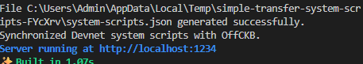
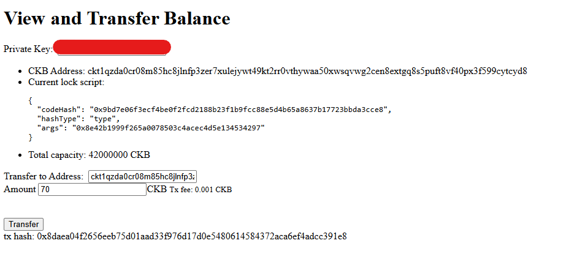
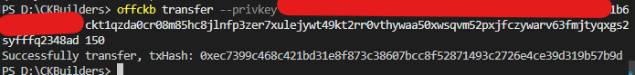

# Transfer CKB

> A single Cell requires at least 61 bytes of storage, equivalent to [61 CKBytes (CKB)](https://docs.nervos.org/docs/tech-explanation/capacity#capacity-mini). Allocating 62 CKB is recommended to cover additional fees in practice.

---

### 1. Run the CKB transfer script

---

### 2. Transaction successful and Transaction Hash on Terminal

---

### 3. Verify the transaction on CKB Explorer

![](
