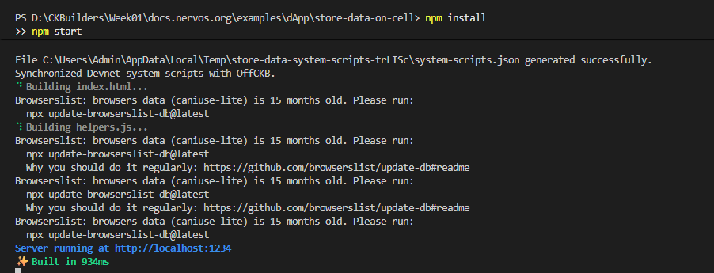
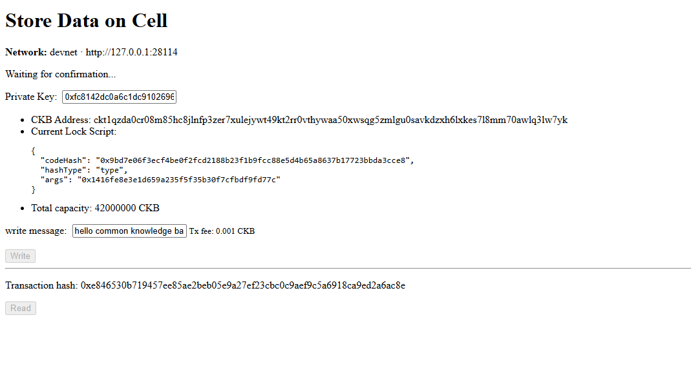
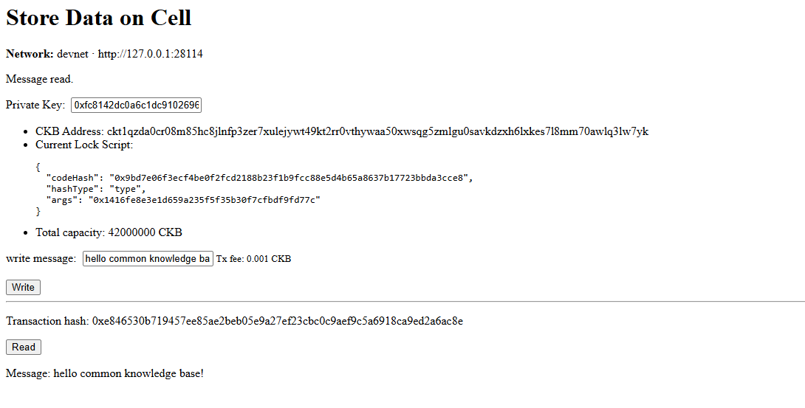

# Store Data on Cell

> In CKB, data can be stored directly inside a Cell's `data` field. The total capacity of the Cell must be large enough to cover the byte size of the data plus the Cell structure itself (at least 61 bytes + data length).

---

### 1. Run the dApp

---

### 2. Write data on Cell successfully

---

### 3. Read message from Cell

