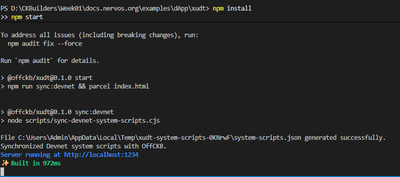
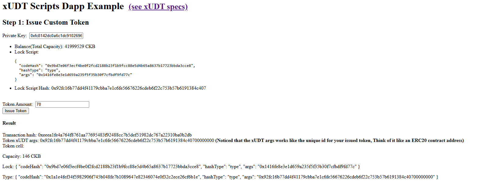
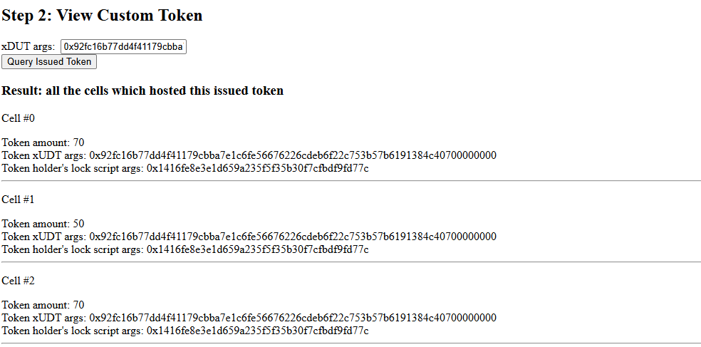
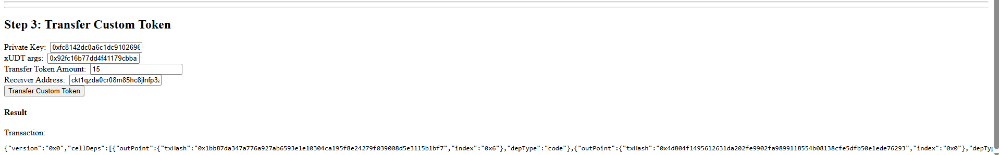

# Create a Fungible Token

> User Defined Tokens (UDT) on CKB are implemented by specifying a Type Script on Cells, commonly adhering to the xUDT standard.

---

### 1. Run the dApp

---

### 2. Issue Custom Token successfully

---

### 3. View Custom Token

---

### 4. Transfer Custom Token

