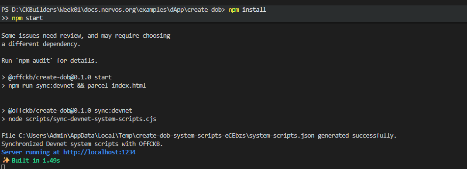
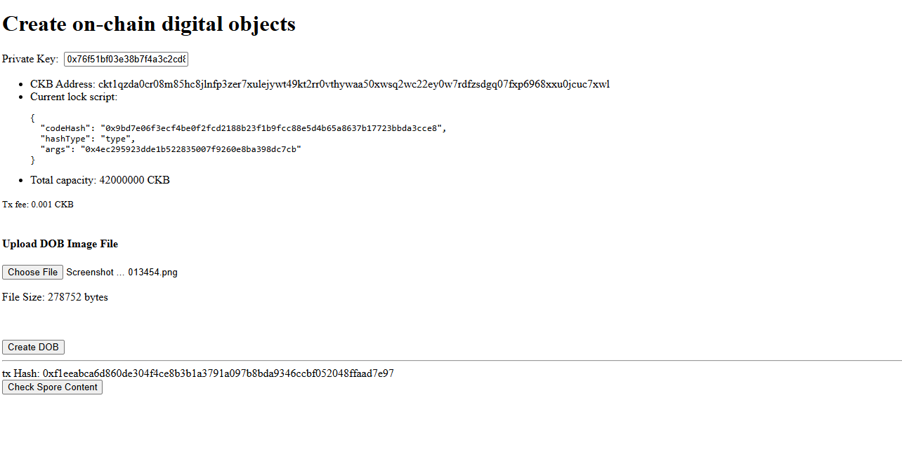
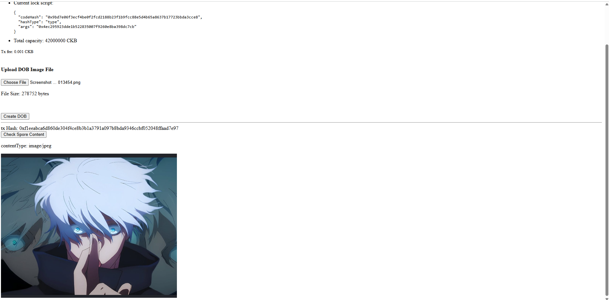

# Create Digital Object (DOB)

> Digital Objects (DOBs) on CKB are built on the Spore protocol, where digital assets are stored entirely on-chain inside Cell data backed by CKB capacity.

---

### 1. Run the dApp

---

### 2. Create on-chain DOB successfully

---

### 3. Check Spore DOB content

