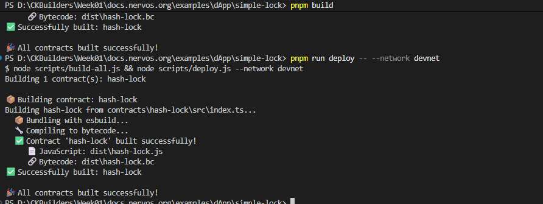
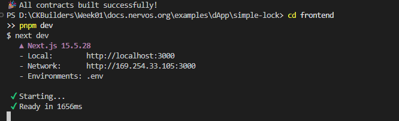
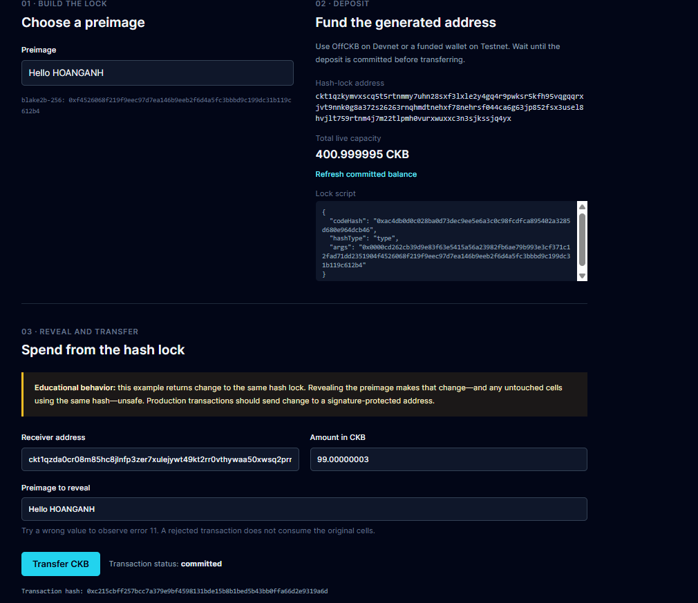

# Build Simple Lock Script

> A Lock Script determines who can unlock and consume a Cell on CKB. A simple hash lock verifies whether a provided preimage matches the hash stored in the script args.

---

### 1. Build contract successfully

---

### 2. Run the dApp

---

### 3. Spend from the Hash Lock

