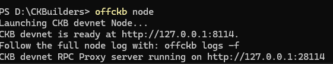

# Week 01 - Environment Setup

## 1. Install OffCKB CLI

```bash
npm install -g @offckb/cli
```


## 2. Start CKB Devnet

```bash
offckb node
```



## 3. Check Accounts

```bash
offckb accounts
```


