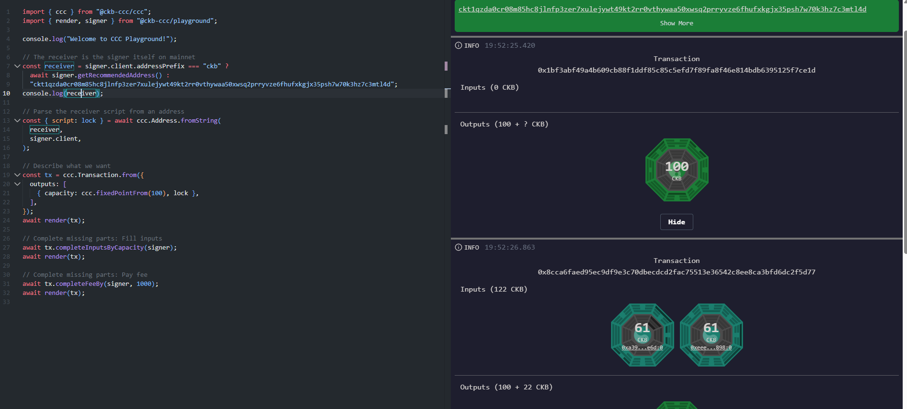
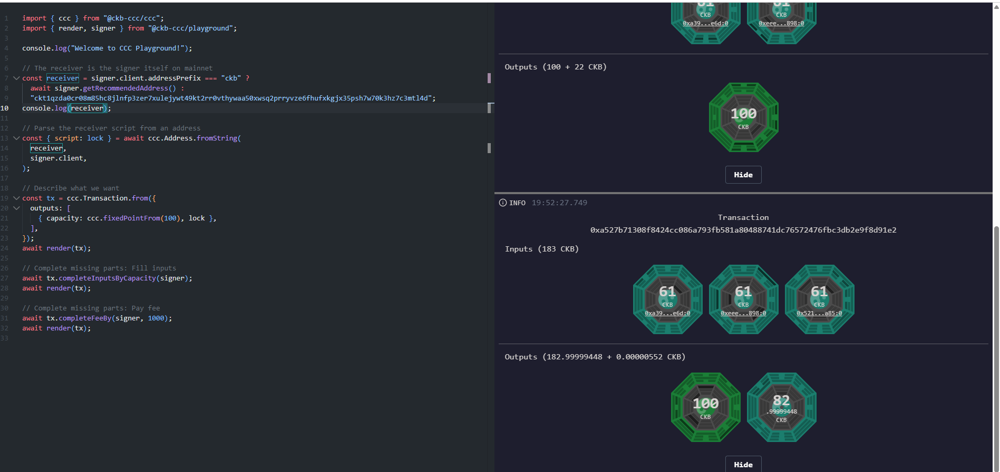
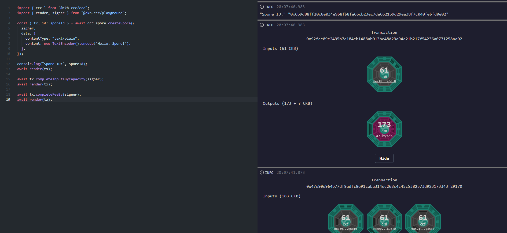
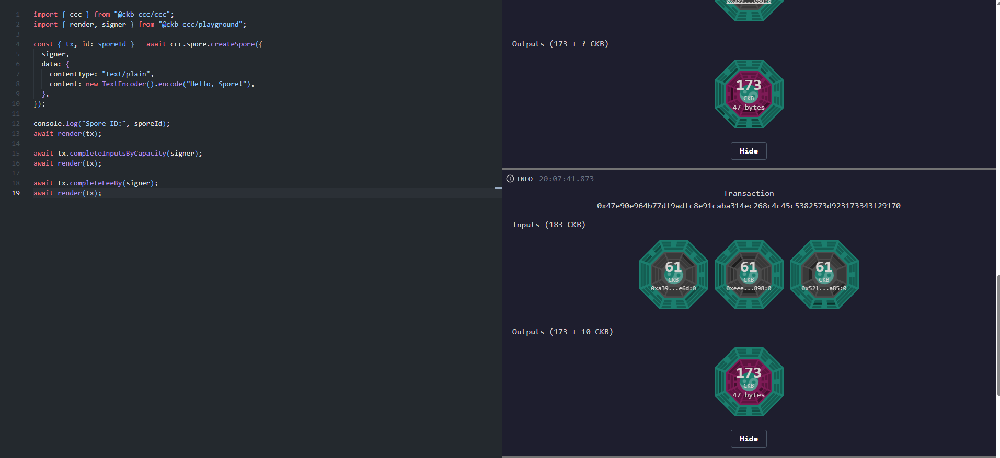
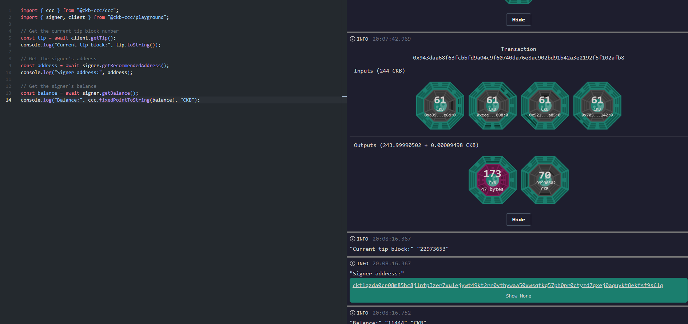

# Introduction to CCC (Common Chains Connector)

> Common Chains Connector (CCC) is the modern JavaScript/TypeScript SDK for Nervos CKB, providing a unified interface across wallets, transaction composition, and asset protocols like Spore.

---

### 1. Transfer CKB: Basic Setup & Initial Output Definition

---

### 2. Complete Inputs by Capacity & Fee Calculation

---

### 3. Spore Protocol Initialization

---

### 4. Spore Inputs & Fee Completion

---

### 5. Query On-Chain Data: Tip Header, Address & Balance

