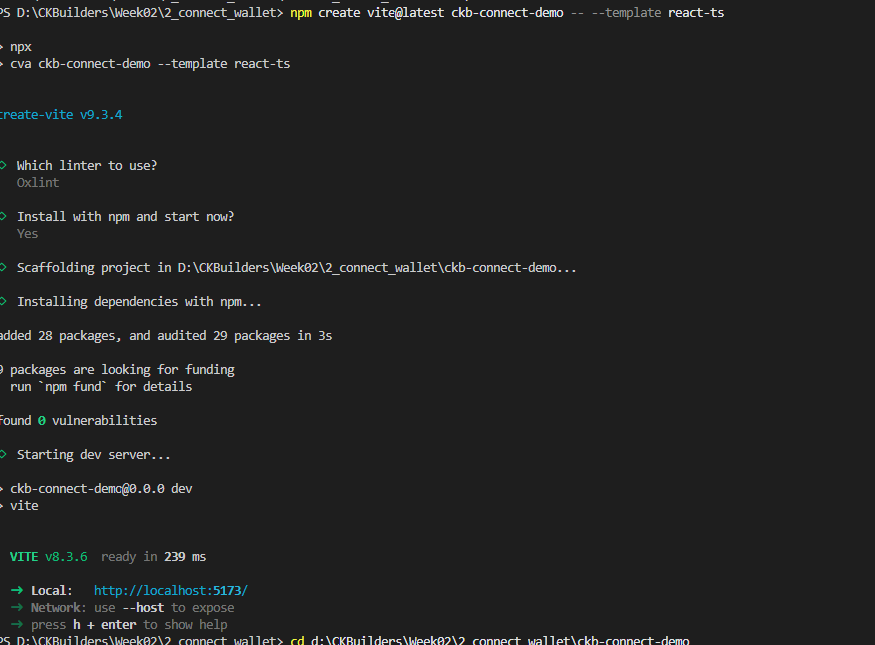
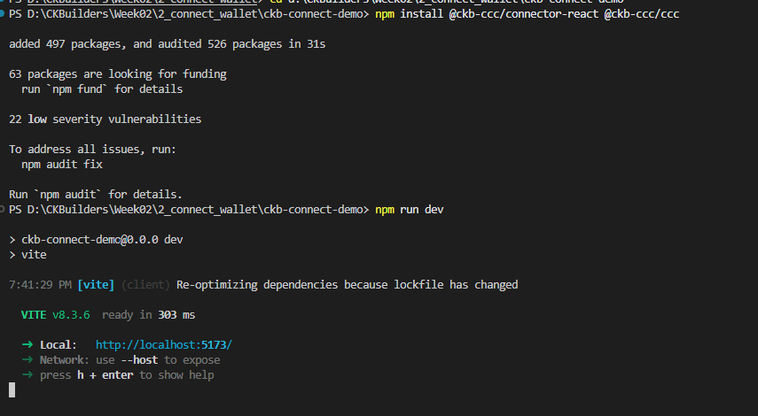
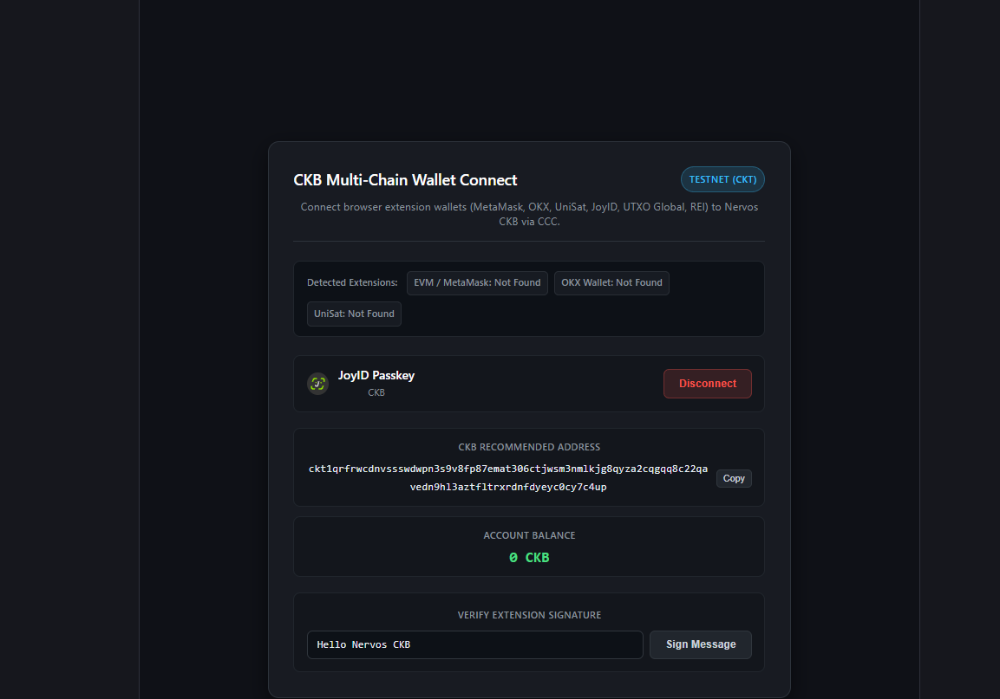

# Connect Wallets with CCC

> Connect multi-chain browser extension wallets (MetaMask, JoyID, OKX, UniSat, UTXO Global, REI) to Nervos CKB through a unified `@ckb-ccc/connector-react` interface.

---

### 1. Create Vite React TypeScript Project

---

### 2. Install CCC Connector SDK & Run Dev Server

---

### 3. Wallet Connected (JoyID Passkey, Address & Balance Display)

