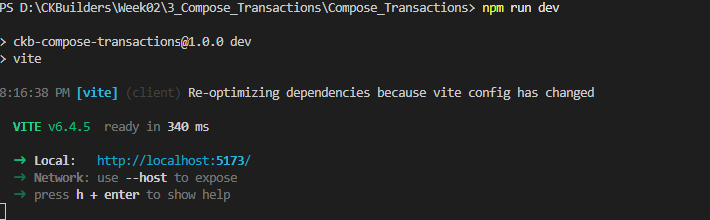
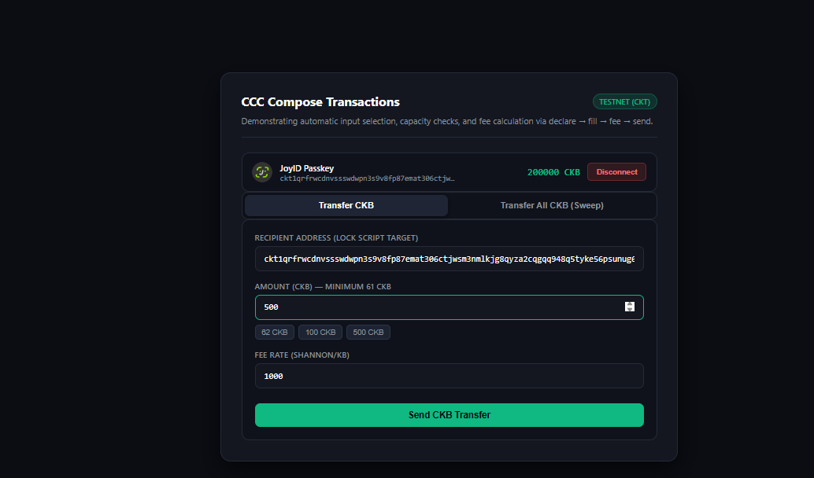
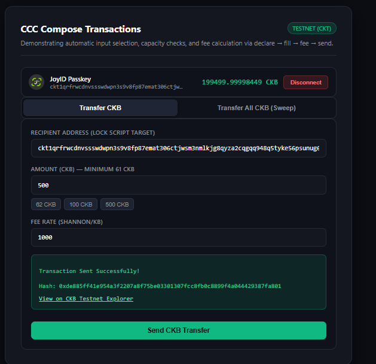
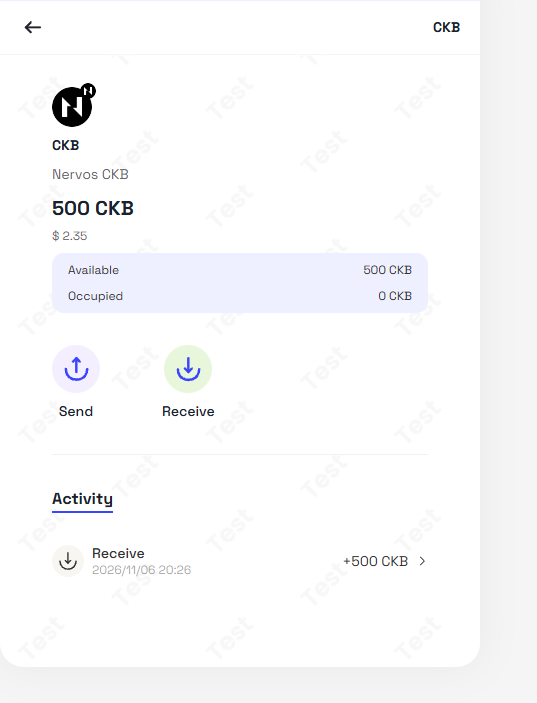

# Compose Transactions on CKB

> Build and send CKB transactions following the **declare → fill → fee → send** pattern with automatic input selection, minimum capacity enforcement (>= 61 CKB), and change fee calculation.

---

### 1. Start Development Server

---

### 2. Compose and Send 500 CKB Transfer

---

### 3. Transaction Broadcast Success & Transaction Hash

---

### 4. Verified on Receiver Wallet (+500 CKB Confirmed On-Chain)

