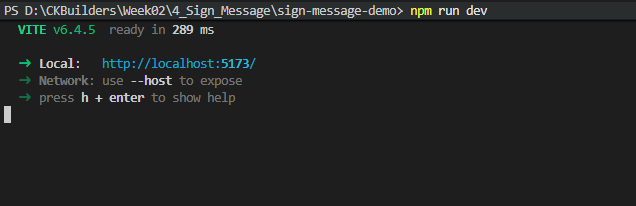
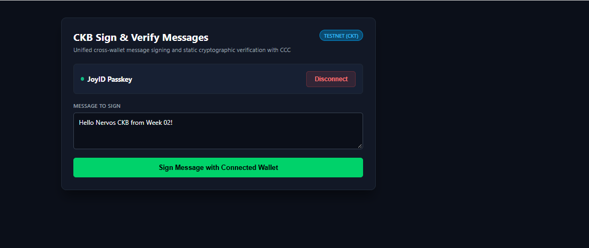
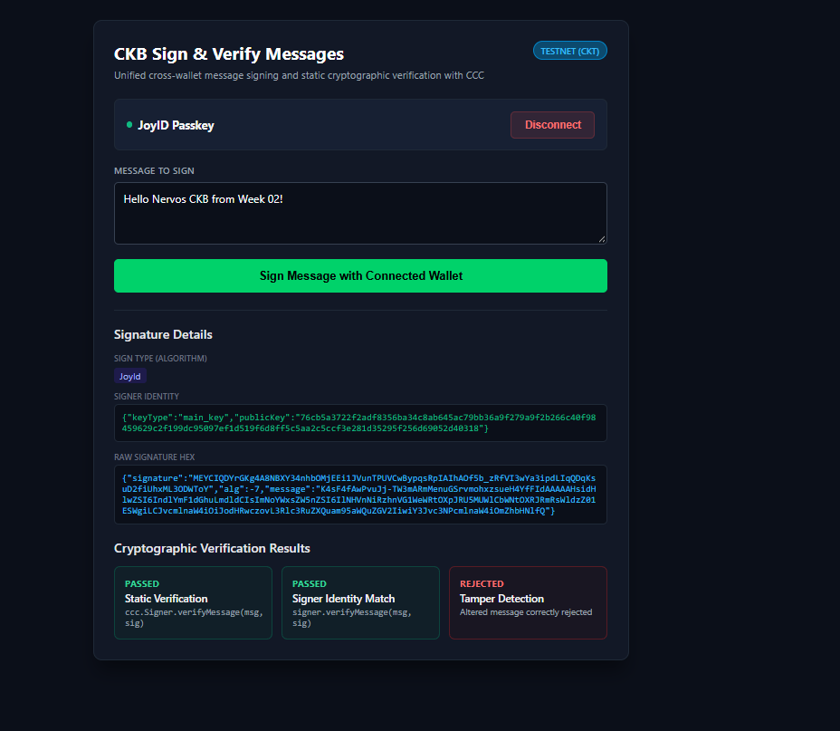

# Sign and Verify Messages with CCC

> Sign arbitrary messages across multi-chain wallets (CKB, JoyID, EVM, BTC) and verify signatures statically using `@ckb-ccc/connector-react`.

---

### 1. Start Development Server

---

### 2. Connect Wallet and Prepare Message to Sign

---

### 3. Signature Details and Cryptographic Verification Passed

