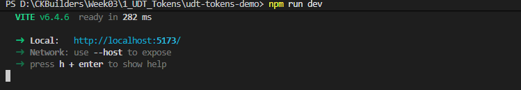
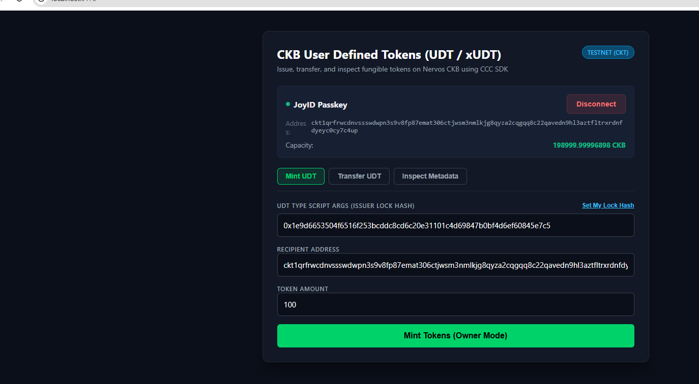
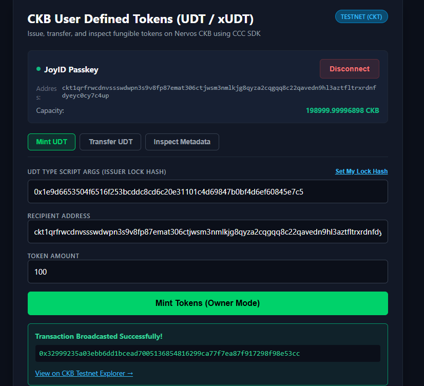
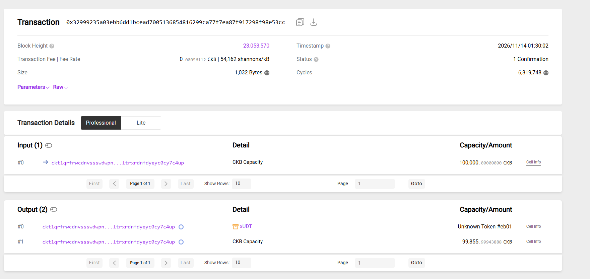
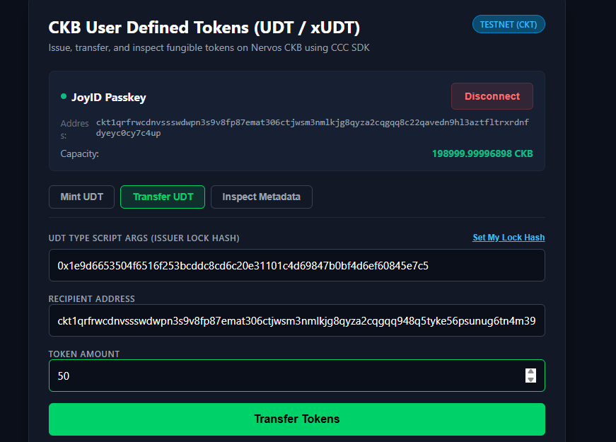
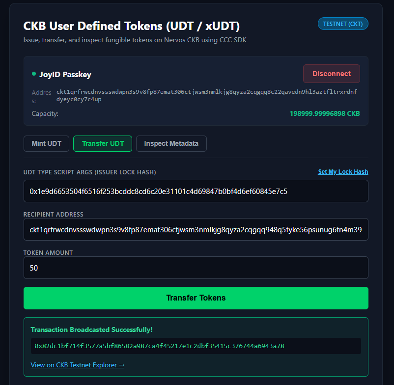
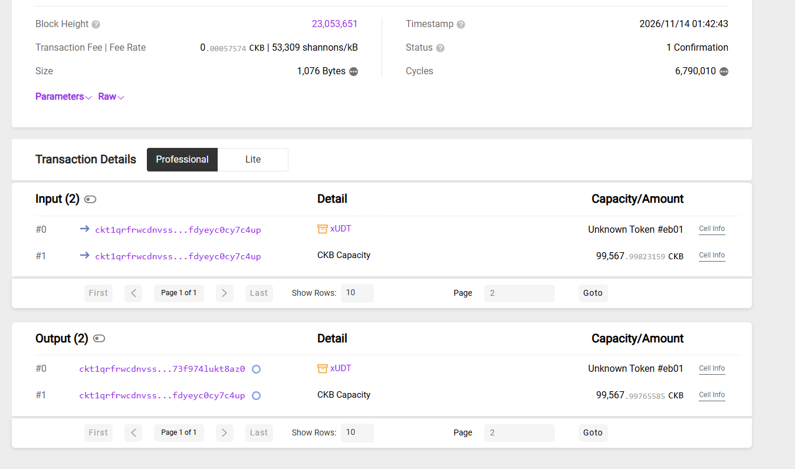

# User Defined Tokens (UDT / xUDT) on CKB

> Issue, transfer, and verify fungible tokens on Nervos CKB using the high-level `ccc.udt.Udt` class with automated capacity balancing and change calculation.

---

### 1. Start UDT Development Server

---

### 2. Configure Token Minting with Issuer Lock Hash

---

### 3. Mint UDT Tokens Broadcasted Successfully

---

### 4. Verify Mint Transaction on CKB Testnet Explorer

---

### 5. Configure UDT Token Transfer

---

### 6. Transfer UDT Broadcasted Successfully

---

### 7. Verify Transfer Transaction on CKB Testnet Explorer

