# Spore Protocol on CKB (Digital Objects - DOBs)

> Create permanent, ownable Digital Objects (DOBs) directly on Nervos CKB using `@ckb-ccc/spore`, featuring 100% on-chain media storage, collection Clusters, and atomic transfers.

---

### 1. Configure On-Chain Image Spore Minting

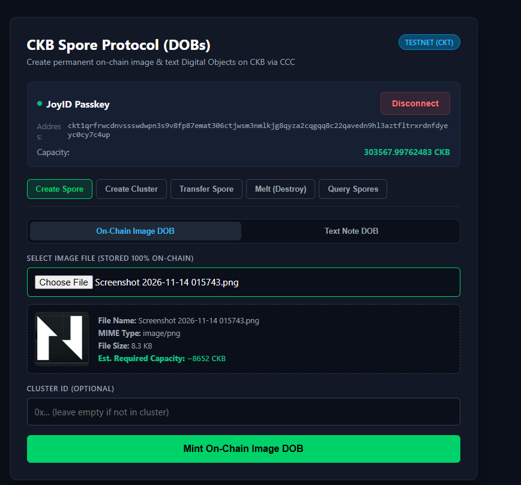

---

### 2. Spore DOB Minted Successfully & Transaction Hash

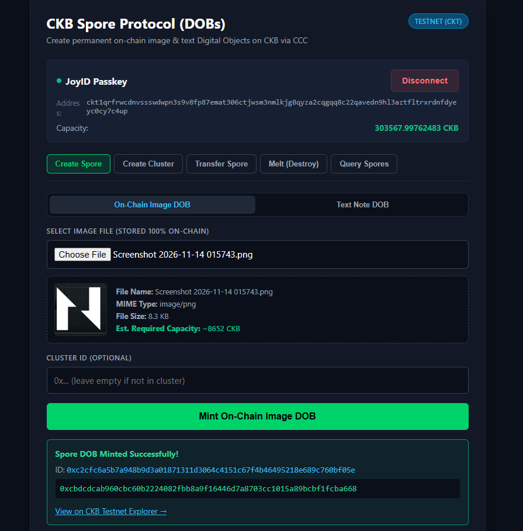

---

### 3. Verify Spore DOB Cell on CKB Testnet Explorer

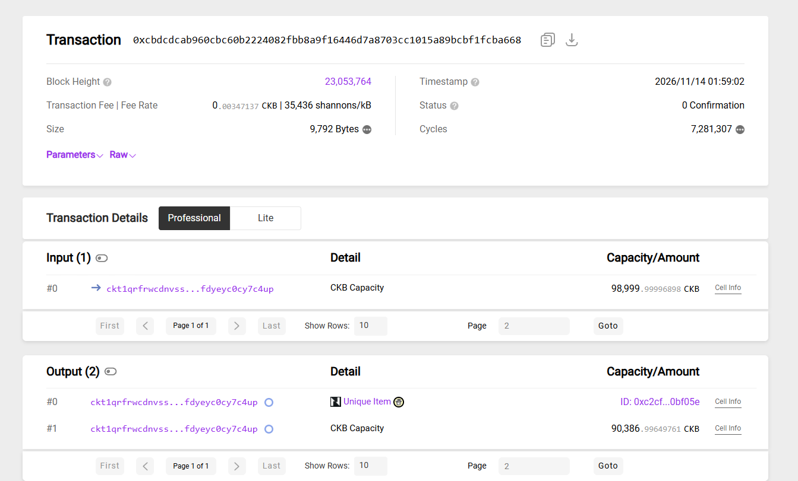

---

### 4. Render On-Chain DOB Image in JoyID Wallet

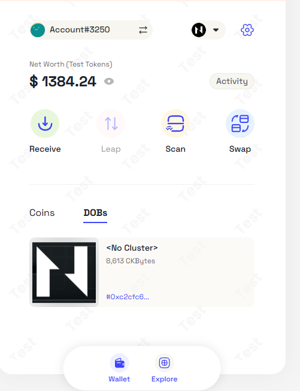

---

### 5. Create Spore Collection Cluster

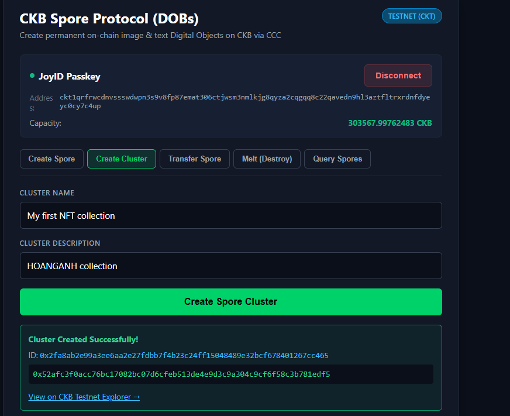

---

### 6. Verify Cluster Cell on CKB Testnet Explorer

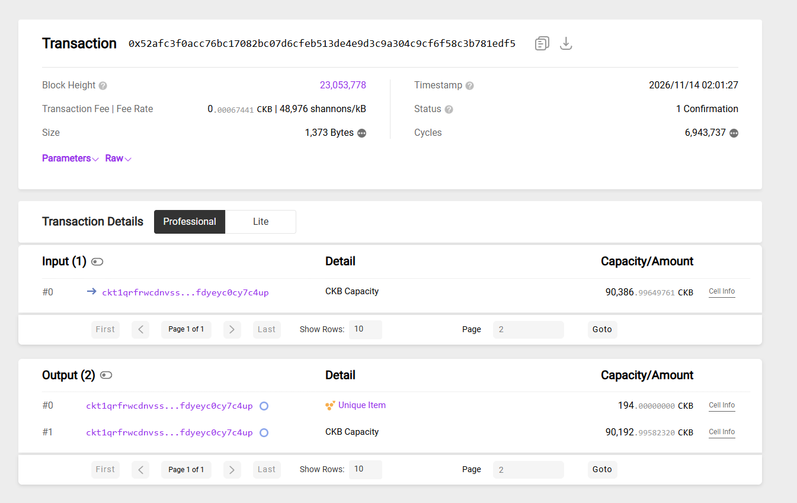

---

### 7. Inspect Spore Cluster Type Script Details

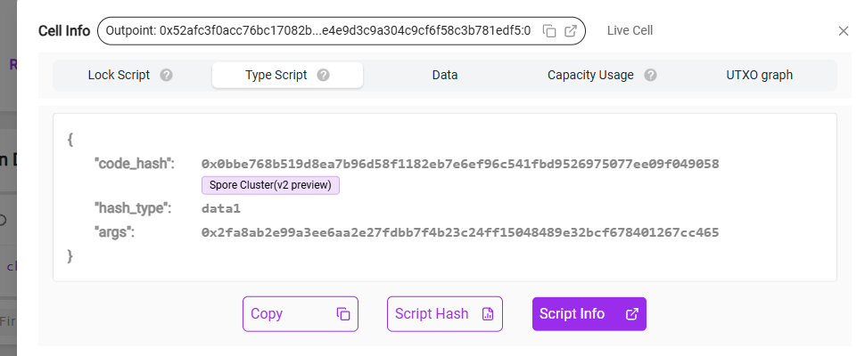

---

### 8. Mint Image Spore Bound to Cluster ID

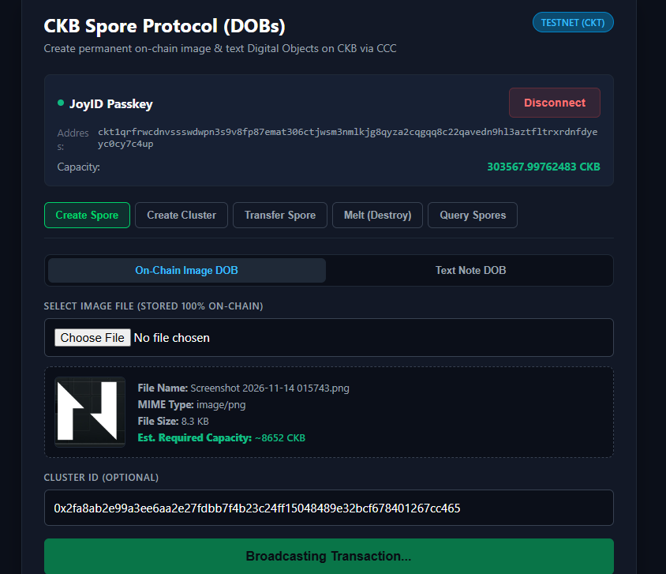

---

### 9. Cluster Spore Minted Successfully

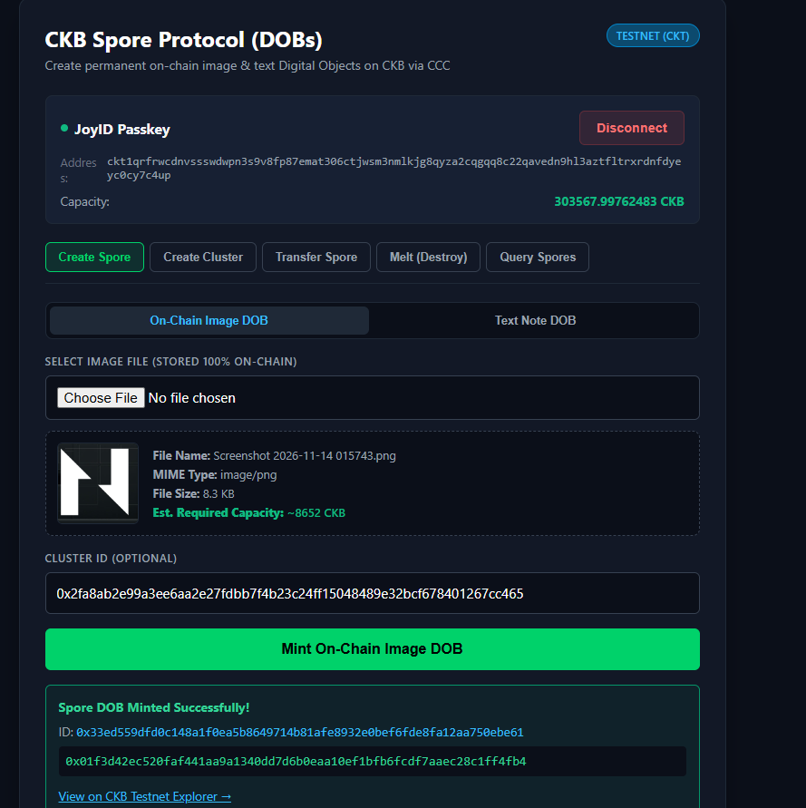

---

### 10. Mint Additional Image Spore into Cluster Collection

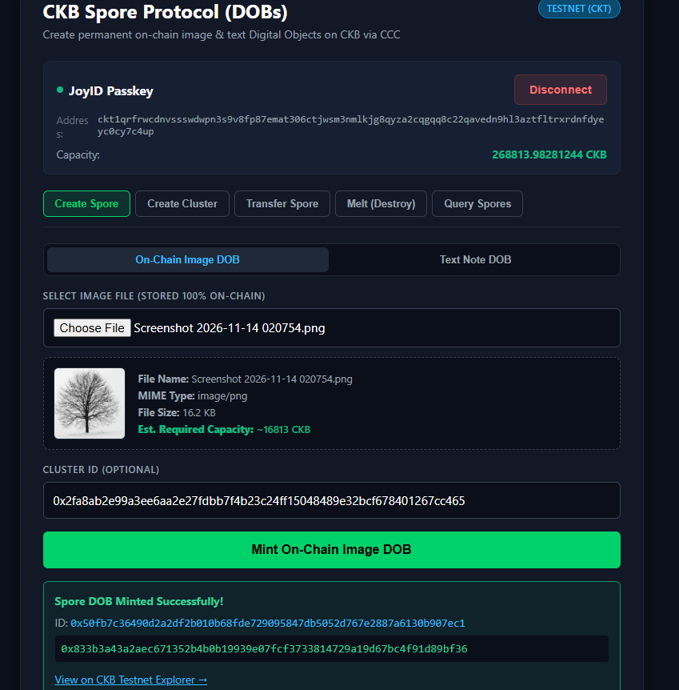

---

### 11. View Complete NFT Collection in JoyID Wallet

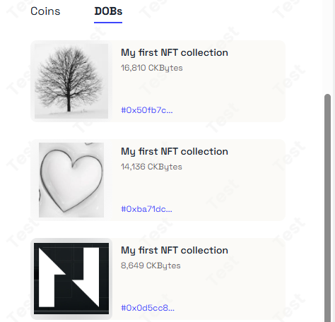

---

### 12. Configure Spore DOB Transfer

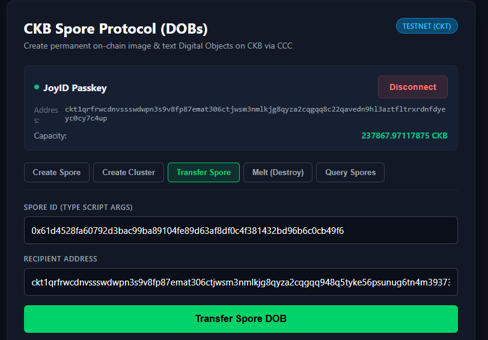

---

### 13. Spore DOB Transfer Broadcasted Successfully

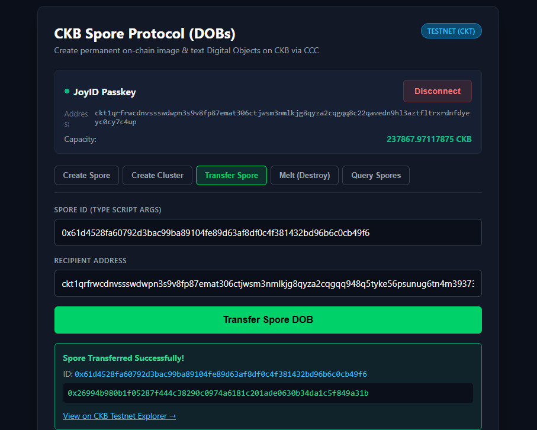

---

### 14. Verify Transfer on CKB Testnet Explorer

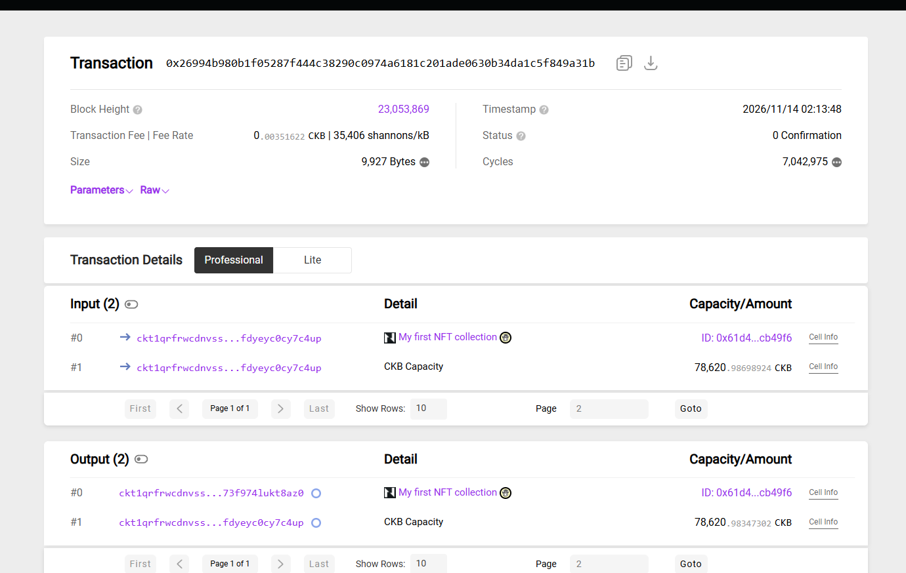

---

### 15. Verified on Recipient JoyID Wallet (DOBs Received)

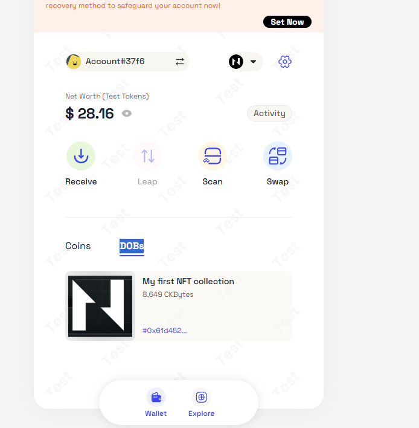
