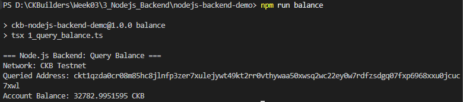
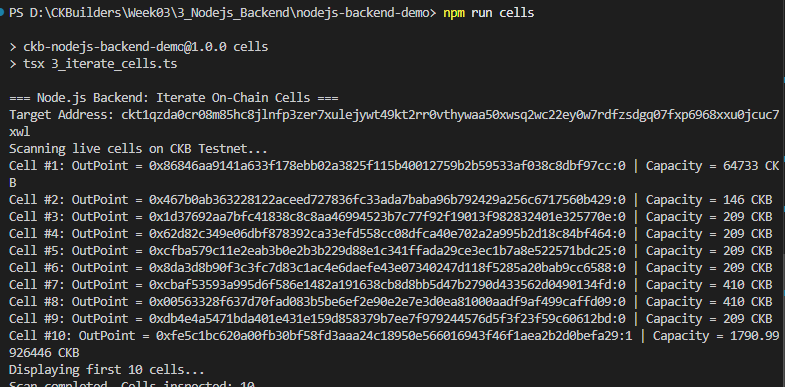
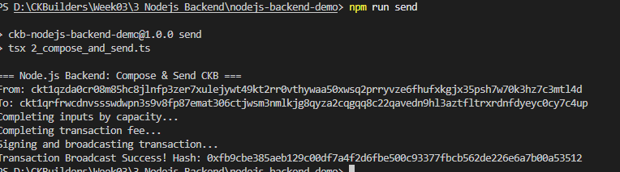
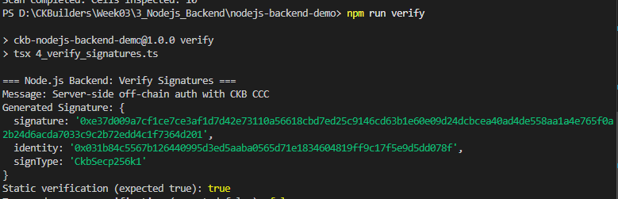
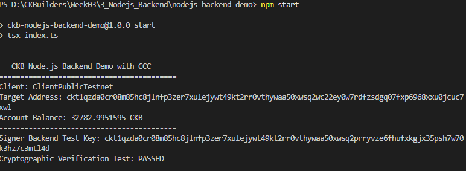

# Node.js Backend Development with CCC

> Build server-side CKB scripts, automated workflows, transaction composition, and backend authentication using `@ckb-ccc/shell` without browser or DOM dependencies.

---

## Architecture Overview

In decentralized application ecosystems, frontend interfaces rely on browser extensions or WebAuthn Passkeys (such as JoyID) for interactive user signatures. However, backend architectures—including payment gateways, automated indexers, oracle feeds, and scheduled batchers—require autonomous, headless execution.

The `@ckb-ccc/shell` package provides native Node.js support for CKB, enabling developers to:
- Connect directly to CKB Testnet/Mainnet over JSON-RPC and WebSockets.
- Query balances and stream on-chain cells for any address without requiring private keys.
- Manage automated signing using `SignerCkbPrivateKey`.
- Compose and broadcast complex transactions following the Declare → Fill → Fee → Send lifecycle.
- Verify cryptographic signatures off-chain for zero-cost API authentication.

---

## Step 1: Query Account Balance on CKB Testnet

Executing `npm run balance` resolves the target address to its underlying lock script and retrieves the account's unspent capacity directly from the network.



### Execution Output & Analysis

```text
=== Node.js Backend: Query Balance ===
Network: CKB Testnet
Queried Address: ckt1qzda0cr08m85hc8jlnfp3zer7xulejywt49kt2rr0vthywaa50xwsq2wc22ey0w7rdfzsdgq07fxp6968xxu0jcuc7xwl
Account Balance: 32782.9951595 CKB
```

- **Address Resolution**: The script takes a public CKB address (`ckt1qzda...`), parses its lock script via `ccc.Address.fromString()`, and retrieves total capacity using `client.getBalance([lock])`.
- **Read-Only Security**: Read operations do not require private keys, allowing backend microservices to monitor balances safely.

---

## Step 2: Iterate On-Chain Live Cells

Executing `npm run cells` connects to CKB Testnet and streams live unspent cells belonging to the specified address.



### Execution Output & Analysis

```text
=== Node.js Backend: Iterate On-Chain Cells ===
Target Address: ckt1qzda0cr08m85hc8jlnfp3zer7xulejywt49kt2rr0vthywaa50xwsq2wc22ey0w7rdfzsdgq07fxp6968xxu0jcuc7xwl
Scanning live cells on CKB Testnet...
Cell #1: OutPoint = 0x86846aa9141a633f178ebb02a3825f115b40012759b2b59533af038c8dbf97cc:0 | Capacity = 64733 CKB
Cell #2: OutPoint = 0x467b0ab363228122aceed727836fc33ada7baba96b792429a256c6717560b429:0 | Capacity = 146 CKB
Cell #3: OutPoint = 0x1d37692aa7bfc41838c8c8aa46994523b7c77f92f19013f982832401e325770e:0 | Capacity = 209 CKB
Cell #4: OutPoint = 0x62d82c349e06dbf878392ca33efd558cc08dfca40e702a2a995b2d18c84bf464:0 | Capacity = 209 CKB
Cell #5: OutPoint = 0xcfba579c11e2eab3b0e2b3b229d88e1c341ffada29ce3ec1b7a8e522571bdc25:0 | Capacity = 209 CKB
Cell #6: OutPoint = 0x8da3d8b90f3c3fc7d83c1ac4e6daefe43e07340247d118f5285a20bab9cc6588:0 | Capacity = 209 CKB
Cell #7: OutPoint = 0xcbaf53593a995d6f586e1482a191638cb8d8bb5d47b2790d433562d0490134fd:0 | Capacity = 410 CKB
Cell #8: OutPoint = 0x00563328f637d70fad083b5be6ef2e90e2e7e3d0ea81000aadf9af499caffd09:0 | Capacity = 410 CKB
Cell #9: OutPoint = 0xdb4e4a5471bda401e431e159d858379b7ee7f979244576d5f3f23f59c60612bd:0 | Capacity = 209 CKB
Cell #10: OutPoint = 0xfe5c1bc620a00fb30bf58fd3aaa24c18950e566016943f46f1aea2b2d0befa29:1 | Capacity = 1790.99926446 CKB
Displaying first 10 cells...
Scan completed. Cells inspected: 10
```

- Each cell on CKB is uniquely identified by its `OutPoint` (`txHash` and output `index`).
- Iteration uses an asynchronous generator via `client.findCellsOnChain()`, streaming cells efficiently without loading historical block data into memory.

---

## Step 3: Compose and Broadcast Transactions with Private Key Signer

Executing `npm run send` demonstrates programmatic transaction composition, autonomous input selection, fee calculation, and live network broadcasting.



### Execution Output & Analysis

```text
=== Node.js Backend: Compose & Send CKB ===
From: ckt1qzda0cr08m85hc8jlnfp3zer7xulejywt49kt2rr0vthywaa50xwsq2prryvze6fhufxkgjx35psh7w70k3hz7c3mtl4d
To: ckt1qrfrwcdnvssswdwpn3s9v8fp87emat306ctjwsm3nmlkjg8qyza2cqgqq8c22qavedn9hl3aztfltrxrdnfdyeyc0cy7c4up
Completing inputs by capacity...
Completing transaction fee...
Signing and broadcasting transaction...
Transaction Broadcast Success! Hash: 0xfb9cbe385aeb129c00df7a4f2d6fbe500c93377fbcb562de226e6a7b00a53512
```

### Transaction Construction Pipeline

1. **Declare Output**: Define destination lock script and intended transfer capacity (e.g. 62 CKB).
2. **`completeInputsByCapacity(signer)`**: The SDK searches the signer's live cells, aggregates required capacity, and adds change cells automatically.
3. **`completeFeeBy(signer)`**: Calculates the exact serialized transaction size in bytes and adjusts change capacity to cover the miner fee.
4. **`sendTransaction(tx)`**: Signs inputs using the secp256k1 private key and pushes the raw transaction to the CKB mempool, returning the transaction hash `0xfb9cbe385aeb129c00df7a4f2d6fbe500c93377fbcb562de226e6a7b00a53512`.

---

## Step 4: Server-Side Cryptographic Signature Verification

Executing `npm run verify` tests message signing with `SignerCkbPrivateKey` and verifies message integrity off-chain via `ccc.Signer.verifyMessage()`.



### Execution Output & Analysis

```text
=== Node.js Backend: Verify Signatures ===
Message: Server-side off-chain auth with CKB CCC
Generated Signature: {
  signature: '0xe37d009a7cf1ce7ce3af1d7d42e73110a56618cbd7ed25c9146cd63b1e60e09d24dcbcea40ad4de558aa1a4e765f0a2b24d6acda7033c9c2b72edd4c1f7364d201',
  identity: '0x031b84c5567b126440995d3ed5aaba0565d71e1834604819ff9c17f5e9d5dd078f',
  signType: 'CkbSecp256k1'
}
Static verification (expected true): true
Tampered message verification (expected false): false
```

- **Off-Chain Verification**: Enables zero-gas authentication for backend APIs, microservices, and user sessions.
- **Tamper Resistance**: If any byte of the message is altered, `verifyMessage` mathematically rejects the signature (`false`).

---

## Step 5: Full Demo Overview Execution

Executing `npm start` executes the comprehensive workflow in a single run: establishes testnet connection, checks target balance, and verifies signer cryptography.



```text
==========================================
   CKB Node.js Backend Demo with CCC
==========================================
Client: ClientPublicTestnet
Target Address: ckt1qzda0cr08m85hc8jlnfp3zer7xulejywt49kt2rr0vthywaa50xwsq2wc22ey0w7rdfzsdgq07fxp6968xxu0jcuc7xwl
Account Balance: 32782.9951595 CKB
------------------------------------------
Signer Backend Test Key: ckt1qzda0cr08m85hc8jlnfp3zer7xulejywt49kt2rr0vthywaa50xwsq2prryvze6fhufxkgjx35psh7w70k3hz7c3mtl4d
Cryptographic Verification Test: PASSED
==========================================
```

---

## Summary & Key Learnings

- **Headless Efficiency**: Backend automation eliminates browser DOM overhead, enabling high-performance daemons and CI/CD pipelines.
- **Security Separation**: Read queries (balance, cells) run completely unauthenticated via public address, while signing authority is isolated to dedicated backend private keys.
- **Deterministic Resource Cleanup**: Using `try ... finally { await clientOwner.dispose(); }` guarantees persistent WebSocket connections terminate cleanly after script execution.
